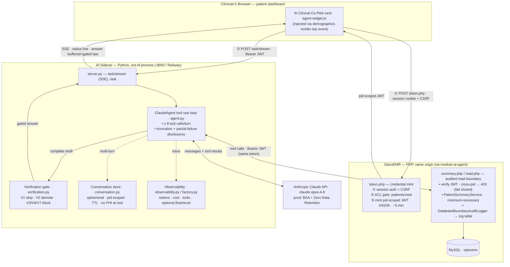
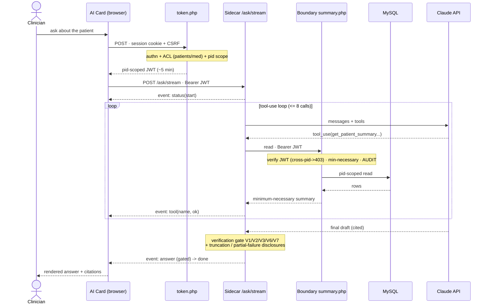

[](https://github.com/openemr/openemr/actions/workflows/syntax.yml)
[](https://github.com/openemr/openemr/actions/workflows/styling.yml)
[](https://github.com/openemr/openemr/actions/workflows/test.yml)
[](https://github.com/openemr/openemr/actions/workflows/js-test.yml)
[](https://github.com/openemr/openemr/actions/workflows/phpstan.yml)
[](https://github.com/openemr/openemr/actions/workflows/rector.yml)
[](https://github.com/openemr/openemr/actions/workflows/shellcheck.yml)
[](https://github.com/openemr/openemr/actions/workflows/docker-compose-lint.yml)
[](https://github.com/openemr/openemr/actions/workflows/docker-lint-hadolint.yml)
[](https://github.com/openemr/openemr/actions/workflows/isolated-tests.yml)
[](https://github.com/openemr/openemr/actions/workflows/inferno-test.yml)
[](https://github.com/openemr/openemr/actions/workflows/composer.yml)
[](https://github.com/openemr/openemr/actions/workflows/composer-require-checker.yml)
[](https://github.com/openemr/openemr/actions/workflows/api-docs.yml)
[](https://codecov.io/gh/openemr/openemr)

[](#backers) [](#sponsors)

# OpenEMR Agent Forge

## Contents
[Installation](#installation)\
[Seeding demo data](#seeding-demo-data)\
[Architecture Diagram](#architecture-diagram)\
[Engineering Deliverables](#engineering-deliverables)\
[Submission Requirements](#submission-requirements) 

## Installation

### 1. Install Docker

Easiest is Docker Desktop for Mac:

<!-- with Homebrew: -->
brew install --cask docker
<!-- then launch it once so the engine starts: -->
open -a Docker

Or download from https://www.docker.com/products/docker-desktop/

Wait until the Docker whale icon in the menu bar says it's running.

### 2. Start the OpenEMR stack

The repo ships a ready-made dev stack:

cd /Users/kevin/Sites/openemr-base-clean/docker/development-easy
docker compose up --detach --wait

First run pulls images and builds the database — it takes several minutes. --wait blocks until containers are healthy.

### 3. Open it

- App: http://localhost:8300/ or https://localhost:9300/
- Login: admin / pass
- phpMyAdmin: http://localhost:8310/


## Seeding demo data

The dev database starts **empty** — a fresh OpenEMR install ships only reference/
config data (code sets, list_options), no patients. We seed synthetic patients
for testing; **no real PHI is ever used.**

### Approach used: OpenEMR `demo-data-generator` (100 patients, demographics-only)

Generates fictional patients via OpenEMR's official tool and loads them into the
dev DB.

```bash
# 1. Clone + install the generator (Python)
git clone --depth 1 https://github.com/openemr/demo-data-generator.git
cd demo-data-generator
python3 -m venv venv && venv/bin/pip install .

# 2. Generate N patients as SQL
venv/bin/demodata patients --count 100 > gen_patients.sql

Two gotchas (the generator is from 2017; the schema is 8.x):
1. It emits a column interpretter that no longer exists → every INSERT aborts.
2. It writes '' for numeric columns, which STRICT_TRANS_TABLES rejects.

We work around both by loading into a text staging table, then copying only
the still-valid columns into patient_data:

MYSQL="docker exec -i development-easy-mysql-1 mariadb -uroot -proot openemr"

# 3. Build a staging table with ALL generator columns as TEXT
GENCOLS="$(sed -n '1p' gen_patients.sql | sed -E 's/.*\(([^)]*)\) VALUES.*/\1/' | tr -d ' ')"
STAGE_DDL=$(echo "$GENCOLS" | tr ',' '\n' | sed 's/.*/`&` TEXT/' | paste -sd ',' -)
VALIDCOLS=$(echo "$GENCOLS" | tr ',' '\n' | grep -vx 'interpretter' | sed 's/.*/`&`/' | paste -sd ',' -)
echo "DROP TABLE IF EXISTS gen_stage; CREATE TABLE gen_stage ($STAGE_DDL);" | $MYSQL

# 4. Load generated rows into staging (retarget table, relax strict mode)
( echo "SET SESSION sql_mode='';"; sed 's/`patient_data`/`gen_stage`/' gen_patients.sql ) | $MYSQL

# 5. Copy the valid columns into patient_data, then drop staging
echo "SET SESSION sql_mode='';
    INSERT IGNORE INTO patient_data ($VALIDCOLS) SELECT $VALIDCOLS FROM gen_stage;
    DROP TABLE gen_stage;" | $MYSQL

Result: 100 patients in patient_data. Demographics only — no encounters,
problems, meds, or results (the generator doesn\'t produce clinical data).
```

## Architecture Diagram

A read-only AI Clinical Co-Pilot attached to OpenEMR through a custom module. The
LLM tool-use loop runs **out-of-process** in a Python sidecar (so the multi-second
call never blocks a PHP-FPM worker); the agent reads the chart only through an
**audited, patient-scoped HTTP boundary**, never a direct DB connection.

### Component & integration view



### Request-sequence view (one turn, end to end)



### Integration seam & trust controls

- **Clean seam, no core changes** — the agent attaches via the `oe-module-ai-agent`
  custom module: a dashboard event injects the card, and two PHP endpoints
  (`token.php`, `summary.php`/`read.php`) are the only touchpoints.
- **Three fail-closed gates** — session + CSRF → **ACL** (`patients/med`) →
  **pid-scoped JWT** (one chart, ~5 min); the boundary re-verifies and 403s on any
  mismatch.
- **Every chart read is audited** at the boundary (who · actual patient-id ·
  purpose · grant/deny).
- **Nothing unverified reaches the clinician** — status streams live, but the
  answer is buffered → verification gate → streamed last; V6 scrubs raw
  identifiers; truncation/partial-failure are disclosed, never silent.
- **No direct DB from the agent** and **no PHI at rest in the sidecar** (ephemeral
  TTL conversation state only).

## Engineering Deliverables
Postman Collection and Environment [here](/postman/)\
Braintrust alerts x5 are document with on-call responses [here](ALERTS.md)\
Week 1 Infrastructure Metrics [here](METRICS_WEEK1.md)\
Stress Test results [here](STRESS_TESTS.md)

## Submission Requirements
Eval dataset [here](EVAL_DATASET.md)\
AI Cost Analysis [here](COST_ANALYSIS.md)