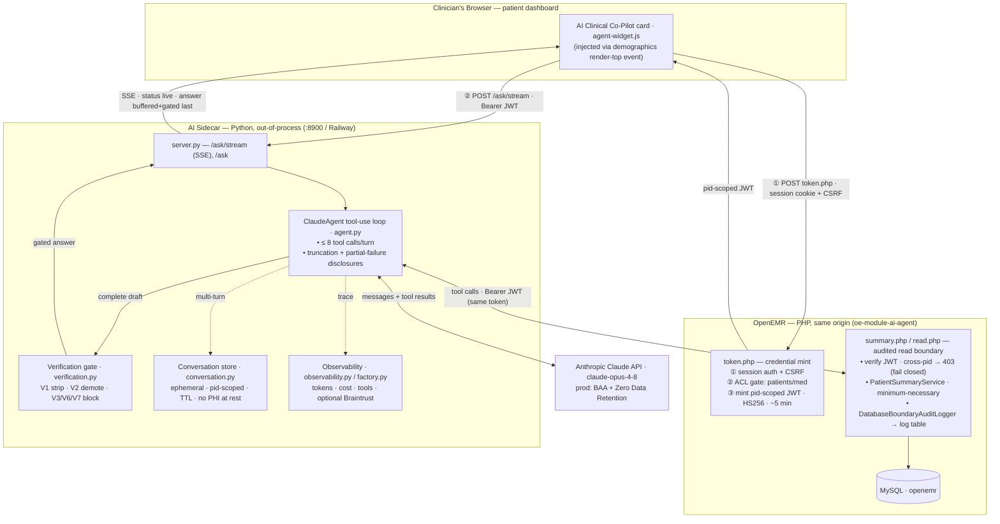
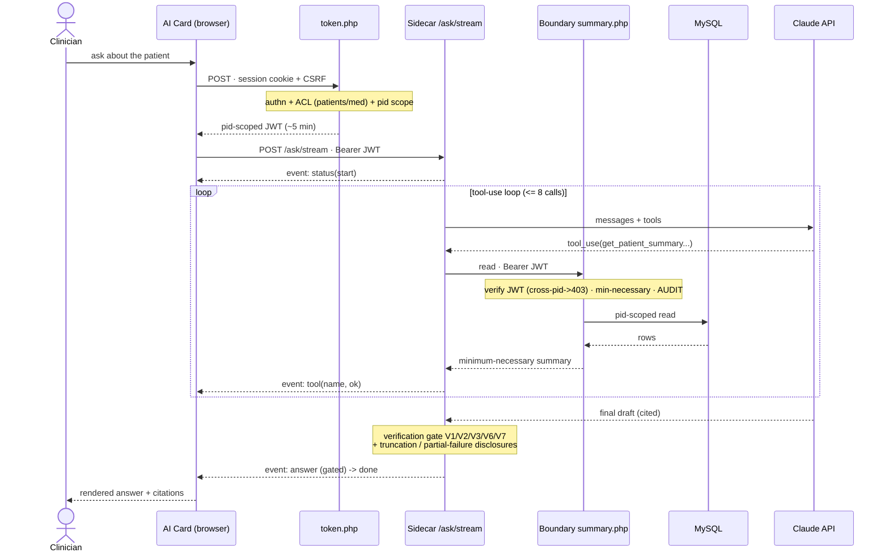

## Architecture Diagram

A read-only AI Clinical Co-Pilot attached to OpenEMR through a custom module. The
LLM tool-use loop runs **out-of-process** in a Python sidecar (so the multi-second
call never blocks a PHP-FPM worker); the agent reads the chart only through an
**audited, patient-scoped HTTP boundary**, never a direct DB connection.

### Component & integration view

### Request-sequence view (one turn, end to end)

### Integration seam & trust controls

- **Clean seam, no core changes** — the agent attaches via the `oe-module-ai-agent`
  custom module: a dashboard event injects the card, and two PHP endpoints
  (`token.php`, `summary.php`/`read.php`) are the only touchpoints.
- **Three fail-closed gates** — session + CSRF → **ACL** (`patients/med`) →
  **pid-scoped JWT** (one chart, ~5 min); the boundary re-verifies and 403s on any
  mismatch.
- **Every chart read is audited** at the boundary (who · actual patient-id ·
  purpose · grant/deny).
- **Nothing unverified reaches the clinician** — status streams live, but the
  answer is buffered → verification gate → streamed last; V6 scrubs raw
  identifiers; truncation/partial-failure are disclosed, never silent.
- **No direct DB from the agent** and **no PHI at rest in the sidecar** (ephemeral
  TTL conversation state only).