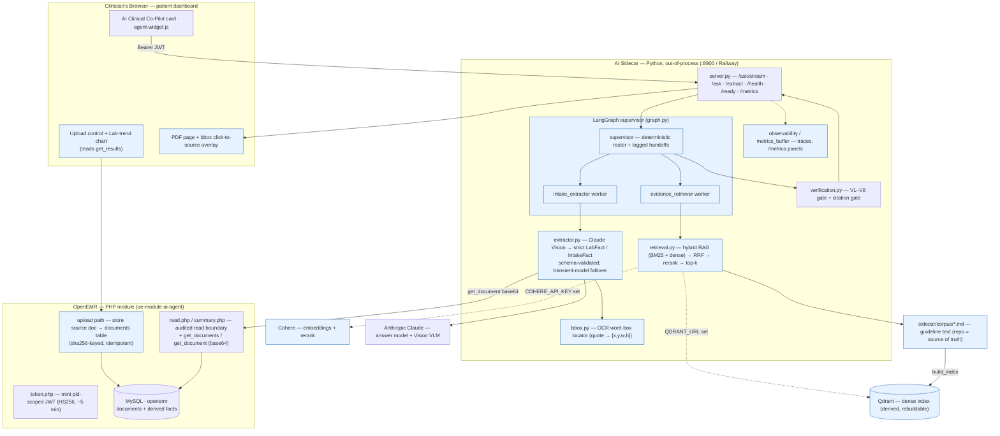
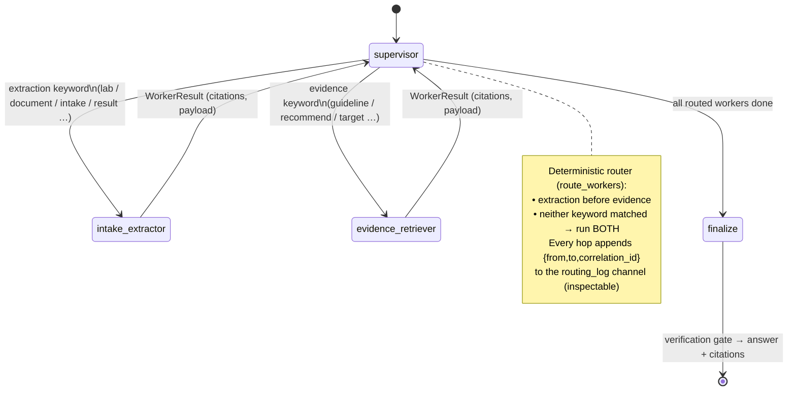
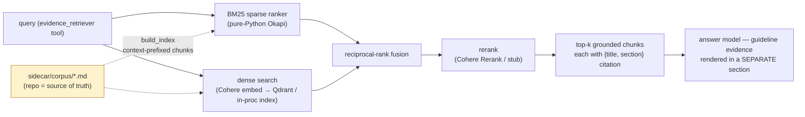
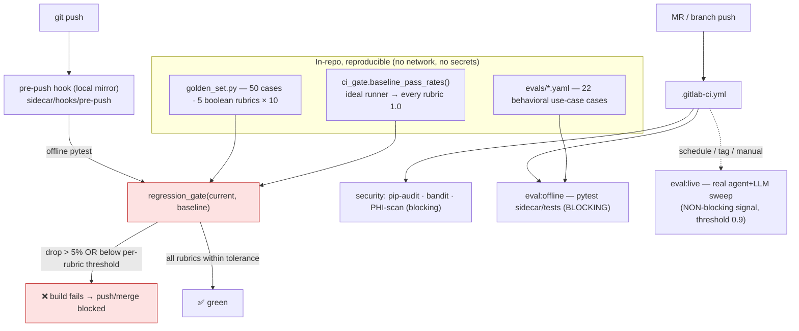

# W2_ARCHITECTURE_DIAGRAM — Week 2 additions, visualized

This file **extends** the [README "Architecture Diagram"](README.md#architecture-diagram)
(the Week-1 component + request-sequence views). It shows where the four Week-2
capabilities — **document ingestion + VLM extraction**, the **LangGraph
supervisor/worker graph**, the **hybrid RAG design**, and the **eval-driven CI
gate** — attach to the system already documented there.

Nothing here replaces the Week-1 trust seam: the pid-scoped, fail-closed,
audited HTTP boundary and the out-of-process sidecar are unchanged. Week 2 is
**additive**. Prose lives in [`W2_ARCHITECTURE.md`](W2_ARCHITECTURE.md).

---

## 1. Where the Week-2 pieces attach (system view)



*Blue = new in Week 2. Everything else is the Week-1 system from the README.*

---

## 2. Document ingestion & VLM extraction flow

```mermaid
sequenceDiagram
    actor Dr as Clinician
    participant Card as AI Card (browser)
    participant Up as Module upload path
    participant DB as documents table
    participant SC as Sidecar /extract
    participant B as read.php (boundary)
    participant VLM as Claude Vision
    participant Box as bbox locator

    Dr->>Card: choose lab PDF / intake form + doc_type
    Card->>Up: upload bytes
    Up->>DB: store, keyed by sha256(content) (idempotent)
    DB-->>Card: document_id
    Card->>SC: POST /extract {pid, document_id, doc_type} · Bearer JWT
    SC->>B: get_document(pid, document_id)
    B-->>SC: base64 bytes (pid-scoped, audited)
    SC->>VLM: vision message + strict-JSON instruction
    VLM-->>SC: {confidence, unsupported_fields, fact{...}}
    Note over SC: ExtractionEnvelope parsed strictly →<br/>LabFact / IntakeFact validated (schema = source of truth)<br/>ungrounded fields forced null, listed unsupported
    SC->>Box: locate source_citation quote on page
    Box-->>SC: [x,y,w,h] or none (graceful)
    SC-->>Card: strict fact + confidence + bbox
    Card-->>Dr: extracted-fact panel + click-to-source overlay
```

Key invariants shown: **store-before-extract** (the agent references a
`document_id`, never raw bytes), **schema is the source of truth** (raw VLM
output is validated before any use), **no invention** (ungrounded field → `null`
+ flagged, never fabricated), and **verifiable overlay** (bbox comes from OCR
geometry, not the model, so it can't be hallucinated).

---

## 3. Worker graph (LangGraph supervisor + workers)



- **Contract:** each worker returns a strict `WorkerResult` (`extra="forbid"`) —
  a worker can't silently change its shape.
- **Tracing:** supervisor span → worker child spans; the correlation id threads
  through every hop, VLM call, and retrieval call.
- **Accumulating channels** (`routing_log`, `worker_results`) use `operator.add`
  reducers so each node *appends*.
- **Note:** the graph is real, compiled, and contract-tested; the live `/ask`
  path is still the flat single-agent loop (the graph is exercised offline and
  in the terminal — see [`W2_DEMO_SCRIPT_FINAL.md`](W2_DEMO_SCRIPT_FINAL.md)).

---

## 4. Hybrid RAG design (evidence grounding)



- **Corpus is authoritative and in-repo**; the vector index is **derived and
  rebuildable** (`build_index`) — reproducible from the repo alone.
- **Contextual retrieval:** each chunk is indexed as
  `context + "\n\n" + text` (authored `<!-- context: … -->` per section, else a
  `"{title}. {section}."` fallback) for BM25 tokens *and* dense embeddings.
- **Swappable vendors** behind typed protocols (`EmbeddingClient`, `VectorIndex`,
  `Reranker`): Cohere/Qdrant are one implementation; offline CI uses
  deterministic stubs — no SDK, no network, no keys.
- **Authority separation:** a guideline chunk is *evidence*, never a
  *patient-record fact*; it can support a recommendation but never stand in for a
  patient-specific value.
- **Resilience:** each dense call has a 2 s timeout, 2 retries, and a circuit
  breaker (opens after 5 consecutive failures, 30 s cooldown) → retrieval
  degrades to a record-only answer while the sidecar stays live.

---

## 5. Eval-driven CI gate



- **Two enforcement points, same offline suite:** a local `pre-push` git hook and
  the blocking `eval:offline` GitLab job — both hermetic, no API key.
- **Regression semantics:** a rubric fails the gate if its pass rate drops **>5%**
  below the reproducible baseline **or** falls below its per-rubric threshold
  (`safe_refusal` and `no_phi_in_logs` are hard **1.0** floors).
- **Live sweep is a non-blocking signal** — a small model + strict LLM graders sit
  below the aspirational 0.9 on a healthy build, so it must never red a healthy
  pipeline. The deterministic offline gate is the grading gate.

Details, results, and the injected-regression demo are in
[`EVAL_DATASET_W2.md`](EVAL_DATASET_W2.md) and
[`W2_CI_EVIDENCE.md`](W2_CI_EVIDENCE.md).
